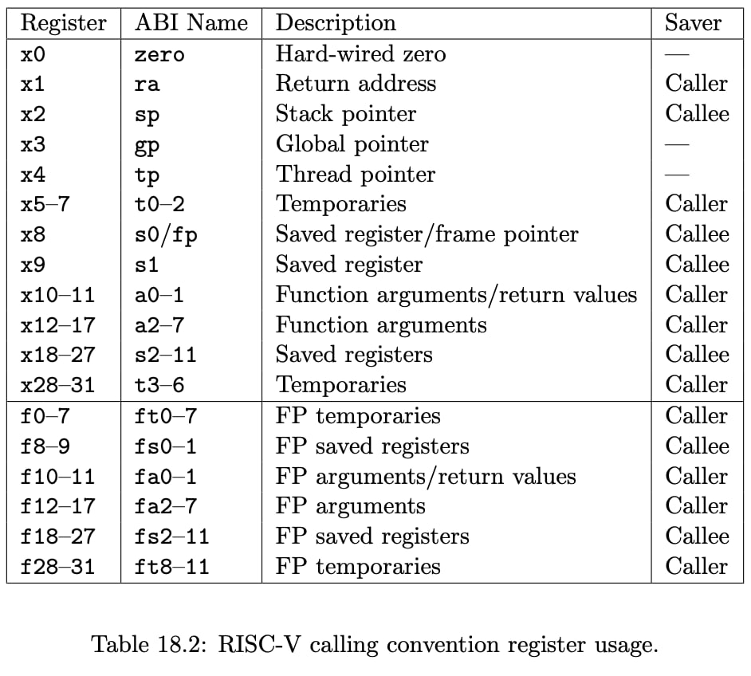

# LEC 5 (TAs): GDB, calling conventions and stack frames RISC-V

## Caller-saved vs. Callee-saved registers

I found the explanation in the video a bit confusing and hard to grasp. So I googled it a found a bunch of resources

1. https://danielmangum.com/posts/risc-v-bytes-caller-callee-registers

> Skimmed through. I got roughly 25% of what he said.

2. (Essentially a link to the first one) https://riscv.org/blog/risc-v-bytes-caller-and-callee-saved-registers-daniel-mangum

> Just a link to the first one.

3. https://stackoverflow.com/questions/64211181/whats-the-difference-between-caller-saved-and-callee-saved-in-risc-v

> AMAZING! Now I understand why it's called "caller" vs. "callee" saved! Wooooooooow. Beauuuutiful. That makes fucking sense.

4. https://ecrionix.org/riscv-from-scratch/day-05-memory-stack-calling-convention/

5. https://shd.mit.edu/2024/recitations/riscv.html

6. https://riscv.org/wp-content/uploads/2024/12/riscv-calling.pdf

7. https://www.cs.cornell.edu/courses/cs3410/2025sp/notes/asm-call.html

---

So the stack-overflow (3) cleared out the whole thing. The reason why we call it `caller-saved` is that the caller saves the registers prior to giving them away to the callee.
A `callee-saved` register is saved by the callee before it is overwritten, and restored by the callee before returning.

## Register ABI

There's this thing called ABI, which apparently stands for Application Binary Interface. To me, it's just some human-readable name we've given to registers. But I'm still a bit pissed off at how alien they look to me (even the abi form). So I asked Gemini 3.8 Flash to give a general overview on them.

Here's result, in my own words:


- x0: Writes to it are discarded
- ra: The caller should take responsibility for saving the return address.
  > Here I have a question. Why don't we use caller-saved registers for everything?
- sp: It should get back to the caller's stack frame. But because the callee might need to change it, it's callee saved (I'm not sure if I'm really convinced here)
- gp, tp: Managed by OS. Not changed by function calls.
- t0-6: All temporary. Strange how they're not immediately after each other. I guess they are caller-saved, so that the callee can freely overwrite without having to deal with storing them, I guess?

  > Throughout the chat with gemini, I realized that it uses `pc + 4`, meaning that after executing each instruction the program counter is added by 4. Turns out each instruction is 4 bytes long in RISC-V that's why the next instruction is at `pc + 4`.

  > Another thing I realized was the actual need for having a `return address` or `ra`. First I thought to myself that once we have `pc` there is no need for a `rc` to exist. After all, it knows where the next instruction is. But later I discovered that `pc` only holds the current place at memory where the current instruction being executed by CPU lives. That's why we need `ra` to tell `pc` should it point at upon finishing execution of the current function (and all its instructions). Nice point!

  > Holy smoke. I just realized why we call them temporary because since they are caller-saved in their life span, you cannot be sure that they stay the same as you valued them because after finishing their current scope and getting out of it, they might be overwritten by their caller. So they're indeed temporary. \
  Update: The same happens for callee-saved ones. So why do we call them temporary?

  > Tired. I guess rest should be learned from practice.

  > Not tired :) Let's connect the `temporary` and `saved` registers to the concept of short-lived and long-lived registers. When you define a variable, if you need it to **live longer** than a few steps and instructions (long-lived), then you have to put it on a `saved` register because if you put it on a `temporary` register, you have to back it up every single time you call a function. You have to do it yourself and that costs a lot of RAM operations. \
  On the other hand, if you use a `saved` register, you're pretty sure that every called function backs it up before using it. So you don't have to back it up every single time you call the function and it's only backed up when a function actually needs to write something on it. So that reduces the number of reads and writes on the memory. \
  But if it's a short-lived variable, then you'd better use a `temporary` register because a `temporary` register is one that gets backed up before calling the function but if the parent function doesn't need it anymore, then it shouldn't really back it up. And since the callee doesn't know if the caller just backed it up or not, it's gonna use it freely. So you're just removing any read or write operations on the memory.

- a0-7: Used for function args and return values. It makes sense for the return value to be caller-saved, otherwise we had to load back the caller's original value of `a0` into `a0` and there would be no way for our child function to pass its return value to its parent. \
  But what about the function arguments? Why are they caller-saved? What difference does that make compared to being callee-saved? I digged a lot. Let it go... 


## Return address
It seems that `jal` replaces the `ra` with the next instruction of the parent function. So if the parent function is a child to another parent (say godfather), the return address to godfather will be lost. That's why we need to backup `ra` prior to calling a function:

```asm
godfather:
  call parent
```

```asm
parent:
  call child
```

before parent calls child, parent's `ra` is set to the next line within `godfather`, afterall, it's where cpu should get back to after finishing `parent`. But when `parent` calls `child`, this `call` replaces `ra` with the next line of the `parent`, cuz that's where cpu should return to after finishing child. So that's why we need to backup `ra` before calling `child`.
