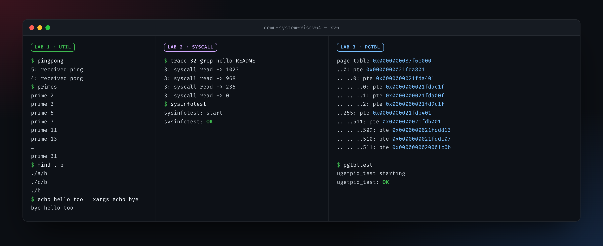
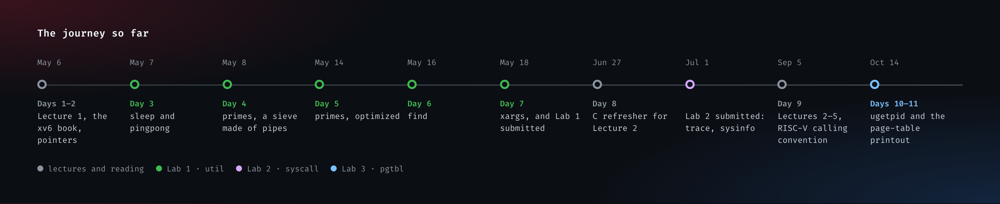

<div align="center">

# Journey

**Working through MIT 6.S081, *Operating System Engineering* (Fall 2021), on my own.**<br>
xv6 on RISC-V, one lecture and one lab at a time, notes and all.

<br>


<br><br>



<sub>Real output: my solutions running in xv6 under QEMU. The scores are from the course's own graders.</sub>

</div>

<br>

> *"If you do not really understand pointers in C, you will suffer untold pain and misery in the labs."*<br>
> — the lab guidelines. They were right.



## Labs

| | Lab | What it took | Status |
| :-- | :-- | :-- | :-- |
| 🟢 | [**1 · util**](https://pdos.csail.mit.edu/6.828/2021/labs/util.html) | [`sleep`](LAB-01/sleep.c), [`pingpong`](LAB-01/pingpong.c), [`primes`](LAB-01/primes.c), [`find`](LAB-01/find.c), [`xargs`](LAB-01/xargs.c). A prime sieve built out of pipes and processes, and one head-shaped dent in a wall. [Notes](LAB-01/Notes.md) | **100/100** |
| 🟣 | [**2 · syscall**](https://pdos.csail.mit.edu/6.828/2021/labs/syscall.html) | `trace` (almost one-shotted it) and `sysinfo`: `argaddr()` to find the user's struct, `copyout()` to fill it, and counting free pages instead of guessing free bytes. [Notes](LAB-02/Notes.md) | **35/35** |
| 🔵 | [**3 · pgtbl**](https://pdos.csail.mit.edu/6.828/2021/labs/pgtbl.html) | ✅ Speed up system calls (`ugetpid`) &nbsp; ✅ Print a page table &nbsp; ⬜ Detect accessed pages. One `panic("freewalk: leaf")` and a forgotten `uvmunmap` later: *men write code, test pass, men happy.* [Notes](LAB-03/Notes.md) | **2 of 3** |

## Lectures

| Lecture | Covered | Notes |
| :-- | :-- | :-- |
| **1 · Introduction** | [video](https://youtu.be/L6YqHxYHa7A), [slides](https://pdos.csail.mit.edu/6.828/2021/slides/6s081-lec-intro.pdf), [notes](https://pdos.csail.mit.edu/6.828/2021/lec/l-overview.txt), chapter 1 of the [xv6 book](https://pdos.csail.mit.edu/6.828/2021/xv6/book-riscv-rev2.pdf), and the [Unix video](https://www.youtube.com/watch?v=tc4ROCJYbm0) for fun | [File descriptors, inodes and why `cd` can't be a program](LEC-01/Notes.md) · [a question for later](LEC-01/sq1.txt) |
| **2 · C and gdb** | [C slides](https://pdos.csail.mit.edu/6.828/2021/lec/6S081-Intro-to-C-Fa21.pdf), [gdb slides](https://pdos.csail.mit.edu/6.828/2021/lec/gdb_slides.pdf), *The C Programming Language* 2.9, 5.1–5.6 and 6.4 | [Bitwise operations](LEC-02/Notes.md), and exercises [2.6 `setbits`](LEC-02/EXERCISES/2.6.c), [2.7 `invert`](LEC-02/EXERCISES/2.7.c), [2.8 `rightrot`](LEC-02/EXERCISES/2.8.c) |
| **3 · OS organization** | chapter 2 of the xv6 book, [video](https://youtu.be/o44d---Dk4o) | |
| **4 · Page tables** | chapter 3 of the xv6 book, [video](https://youtu.be/f1Hpjty3TT8) | Learned it, couldn't explain it yet. The labs fixed that. |
| **5 · Calling conventions** | [RISC-V calling convention](https://pdos.csail.mit.edu/6.828/2021/readings/riscv-calling.pdf), [video](https://youtu.be/s-Z5t_yTyTM) | [Caller- vs callee-saved registers](LEC-05/Notes.md), and a [register cheat sheet](LEC-05/RISC-V_Registers.jpg) |

## Before the first lab

- The [lab guidelines](https://pdos.csail.mit.edu/6.828/2021/labs/guidance.html): *only when you have a firm grasp of the assignment and solution, then start coding.* Oops.
- The [pointers exercise](https://pdos.csail.mit.edu/6.828/2019/lec/pointers.c). Work part 5 out on paper.
- `script` for recording terminal sessions, and gdb ([slides](https://pdos.csail.mit.edu/6.828/2019/lec/gdb_slides.pdf)).
- [Git for Computer Scientists](https://eagain.net/articles/git-for-computer-scientists/) and [*The UNIX Time-Sharing System*](https://pdos.csail.mit.edu/6.828/2021/readings/ritchie78unix.pdf) are still on the list.

## Building xv6 on a recent toolchain

The [2021 labs](https://pdos.csail.mit.edu/6.828/2021/tools.html) (`git://g.csail.mit.edu/xv6-labs-2021`) don't compile with today's GCC as they are. Two lines in the `Makefile` fix that:

```makefile
CFLAGS += -Wno-error=infinite-recursion
CFLAGS += -Wno-error=incompatible-pointer-types
```
