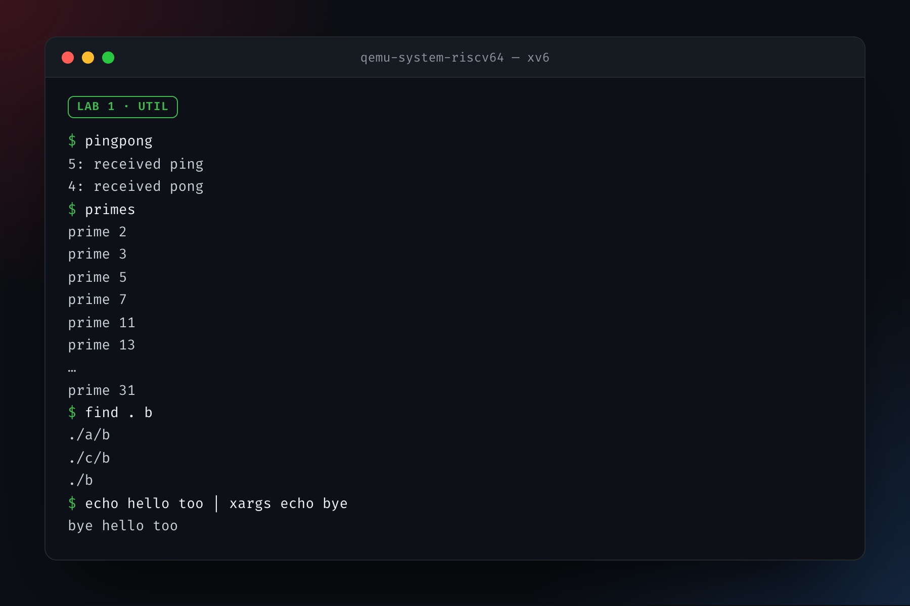
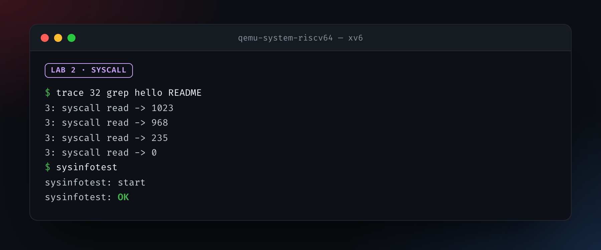
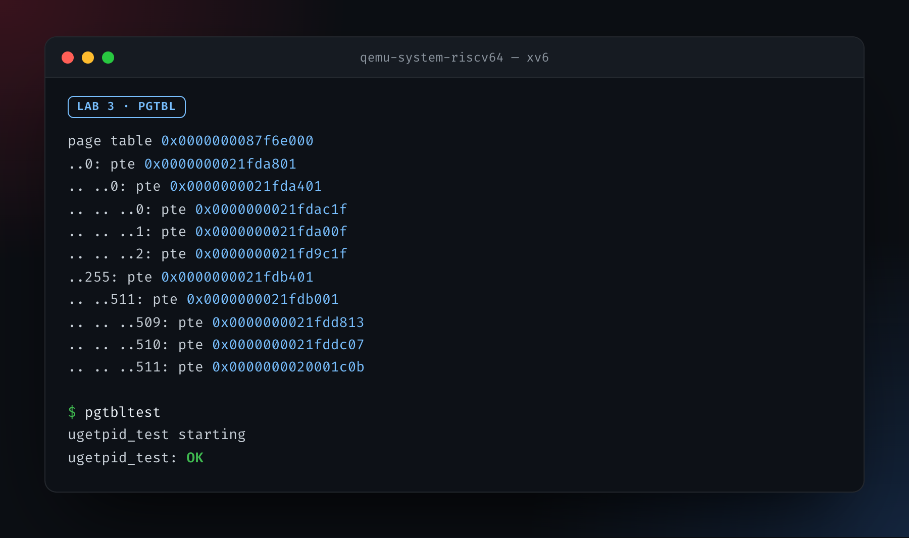

<div align="center">

# Journey

**Working through MIT 6.S081, *Operating System Engineering* (Fall 2021), on my own.**<br>
xv6 on RISC-V, one lecture and one lab at a time.

<br>


</div>

<br>

| | Lecture | Lab |
| :-- | :-- | :-- |
| ✅ | [1 · Introduction](#lecture-1--introduction) | [Lab 1 · util](#-lab-1--util) |
| ✅ | [2 · C and gdb](#lecture-2--c-and-gdb) | |
| ✅ | [3 · OS organization](#lecture-3--os-organization) | [Lab 2 · syscall](#-lab-2--syscall) |
| ✅ | [4 · Page tables](#lecture-4--page-tables) | |
| 🚧 | [5 · Calling conventions](#lecture-5--calling-conventions) | [Lab 3 · pgtbl](#-lab-3--pgtbl) |

---

## Lecture 1 · Introduction

- [x] [Video](https://youtu.be/L6YqHxYHa7A)
- [x] [Introduction slides](https://pdos.csail.mit.edu/6.828/2021/slides/6s081-lec-intro.pdf)
- [ ] [Example](https://pdos.csail.mit.edu/6.828/2021/lec/l-overview/)
- [x] Chapter 1 of the [xv6 book](https://pdos.csail.mit.edu/6.828/2021/xv6/book-riscv-rev2.pdf)
- [x] [Notes](https://pdos.csail.mit.edu/6.828/2021/lec/l-overview.txt)
- [x] [The Unix video](https://www.youtube.com/watch?v=tc4ROCJYbm0), for my amusement
- [x] [A random lecture question](LEC-01/sq1.txt)

📝 [My notes](LEC-01/Notes.md)

### Before the first lab

- [ ] [Lab guidelines](https://pdos.csail.mit.edu/6.828/2021/labs/guidance.html)

  > *Only when you have a firm grasp of the assignment and solution, then start coding.*

  Oops!

  > *If you do not really understand pointers in C, you will suffer untold pain and misery in the labs.*

  LMAO. The "untold pain and misery" part got me. XD

  - [x] [Pointers exercise](https://pdos.csail.mit.edu/6.828/2019/lec/pointers.c). So interesting. Working out part 5 with pen and paper is highly recommended.
  - [x] Learn about the `script` command in Unix
  - [ ] [Git for Computer Scientists](https://eagain.net/articles/git-for-computer-scientists/), a bit hard to grasp
  - [x] The gdb guides in the lab, and the [gdb slides](https://pdos.csail.mit.edu/6.828/2019/lec/gdb_slides.pdf)
- [ ] [Course reference materials](https://pdos.csail.mit.edu/6.828/2021/reference.html)
  - [ ] [The UNIX Time-Sharing System](https://pdos.csail.mit.edu/6.828/2021/readings/ritchie78unix.pdf)

### 🟢 Lab 1 · util

[Assignment](https://pdos.csail.mit.edu/6.828/2021/labs/util.html) &nbsp;·&nbsp; 📝 [My notes](LAB-01/Notes.md) &nbsp;·&nbsp; **100/100**

- [x] [Set up the tools](https://pdos.csail.mit.edu/6.828/2021/tools.html) and compile xv6
- [x] Clone `git://g.csail.mit.edu/xv6-labs-2021`
  - [x] Had to add two lines to the `Makefile` before it would compile (see [the end of this page](#building-xv6-on-a-recent-toolchain))
- [x] [`sleep`](LAB-01/sleep.c)
- [x] [`pingpong`](LAB-01/pingpong.c)
- [x] [`primes`](LAB-01/primes.c)
  - [x] [Nik's answer for making `.nanorc` work on macOS](https://stackoverflow.com/questions/73150633/nano-settings-are-not-adopted-from-nanorc-file)
  - [x] Optimize the code
- [x] [`find`](LAB-01/find.c)
  - [x] *The C Programming Language*, section 5.5
  - [x] Suffer untold pain and misery
- [x] [`xargs`](LAB-01/xargs.c)
  - [x] Hit my head against the wall
  - [x] Clean it up!

<p align="center"></p>

---

## Lecture 2 · C and gdb

- [x] [C slides](https://pdos.csail.mit.edu/6.828/2021/lec/6S081-Intro-to-C-Fa21.pdf)
- [x] [gdb slides](https://pdos.csail.mit.edu/6.828/2021/lec/gdb_slides.pdf)
- [x] *The C Programming Language*, 2.9: bitwise operations
  - [x] [Exercise 2.6: `setbits`](LEC-02/EXERCISES/2.6.c)
  - [x] [Exercise 2.7: `invert`](LEC-02/EXERCISES/2.7.c)
  - [x] [Exercise 2.8: `rightrot`](LEC-02/EXERCISES/2.8.c)
  - [x] Read through 5.1 to 5.6, and 6.4

📝 [My notes](LEC-02/Notes.md)

---

## Lecture 3 · OS organization

- [x] Chapter 2 of the xv6 book
- [x] [Video](https://youtu.be/o44d---Dk4o)

### 🟣 Lab 2 · syscall

[Assignment](https://pdos.csail.mit.edu/6.828/2021/labs/syscall.html) &nbsp;·&nbsp; 📝 [My notes](LAB-02/Notes.md) &nbsp;·&nbsp; **35/35**

- [x] `trace`
- [x] `sysinfo`

<p align="center"></p>

---

## Lecture 4 · Page tables

- [x] Chapter 3 of the xv6 book
- [x] [Video](https://youtu.be/f1Hpjty3TT8)

> Honestly, I didn't get much out of it. It was hard to grasp the whys behind the memory numbering, and I also have some trouble understanding the page layout. That feeling when you've learned something but you can't talk about it (so you don't actually know it). I'll get better once I get to the labs.

> I got it! And wrote a blog post about it: [Page Tables — What MIT 6.828 Taught Me
](https://davoud.blog/posts/page-tables)

---

## Lecture 5 · Calling conventions

- [x] [gdb slides](https://pdos.csail.mit.edu/6.828/2021/lec/gdb_slides.pdf)
- [x] [RISC-V calling conventions](https://pdos.csail.mit.edu/6.828/2021/readings/riscv-calling.pdf) (or [here](https://riscv.org/wp-content/uploads/2024/12/riscv-calling.pdf))
- [x] [Video](https://youtu.be/s-Z5t_yTyTM)

📝 [My notes](LEC-05/Notes.md)

### 🔵 Lab 3 · pgtbl

[Assignment](https://pdos.csail.mit.edu/6.828/2021/labs/pgtbl.html) &nbsp;·&nbsp; 📝 [My notes](LAB-03/Notes.md) &nbsp;·&nbsp; **2 of 3**

- [x] Speed up system calls (easy)
- [x] Print a page table (easy)
- [ ] Detect which pages have been accessed (hard)

<p align="center"></p>

---

### Building xv6 on a recent toolchain

The 2021 labs don't compile with today's GCC as they are. Two lines in the `Makefile` fix that:

```makefile
CFLAGS += -Wno-error=infinite-recursion
CFLAGS += -Wno-error=incompatible-pointer-types
```
